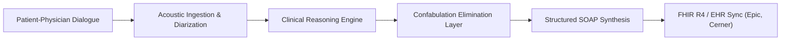

# Anamna Clinical

> **Human-First Clinical Conversation Intelligence**  
> *Restoring the sacred dialogue of care — turning patient-clinician conversations into structured, confabulation-free clinical documentation in real time.*

[](LICENSE)
[](https://hl7.org/fhir/)
[](#the-science-of-confabulation-elimination)
[](#enterprise-scalability)

---

## 🩺 The Mission: Restoring Humanity to Medicine

Modern clinicians spend more than two hours entering EHR documentation for every one hour spent with patients. This administrative burden has severed the physician-patient relationship, turning healers into data-entry technicians staring at computer screens.

**Anamna Clinical** is designed to eliminate this burden entirely:
- **Eye Contact Restored**: Physicians interact directly with patients without computer screens intervening.
- **Ambient Listening**: High-fidelity acoustic diarization isolates physician and patient speech within complex clinical environments.
- **100% Auditory Grounding**: Every sentence in the generated SOAP note is mathematically and acoustically anchored to the encounter audio, eliminating clinical hallucinations and confabulations.

---

## 🌟 Key Capabilities

### 1. Acoustic Dialogue & Conversational Diarization
- Multi-speaker spatial and tonal recognition tailored for high-noise clinic rooms and hospital wards.
- Clinical dialect and terminology normalization spanning 50+ medical sub-specialties.

### 2. The Science of Confabulation Elimination
- Medical documentation demands zero error tolerance. Anamna deploys a multi-layer verification pipeline:
  - **Acoustic Alignment Engine**: Maps generated medical statements to precise millisecond audio timestamps.
  - **Fact Consistency Checks**: Cross-references patient statements (e.g., symptom severity, drug dosages) against clinical guidelines before note finalization.
  - **Interactive Source Citations**: Clinicians can hover over any note claim to hear and review the exact source dialogue.

### 3. Real-Time EHR & FHIR Integration
- Instant synchronization with leading hospital EHR systems (Epic Systems, Cerner, MEDITECH).
- Direct mapping to FHIR R4 resources (`Encounter`, `Observation`, `Condition`, `MedicationStatement`, `CarePlan`).
- Automatic ICD-10-CM and CPT coding recommendations with clinical decision support validation.

### 4. Interactive In-Clinic Encounter Simulator
- Integrated interactive demonstration environment allowing evaluators to preview real-time encounter transcription, live waveform dynamics, and synchronized SOAP generation.

---

## 🏛️ System Architecture



- **Frontend Core**: Semantic HTML5, Editorial Typography (Avantt Type System), Modern CSS Architecture, Responsive Grid & Flexbox, GSAP Motion Engine.
- **Server Runtime**: Node.js High-Performance Microservice.
- **Interoperability**: HL7 v2.x, FHIR R4, JSON-LD Clinical Ontologies.

---

## 🚀 Quickstart

### Prerequisites
- [Node.js](https://nodejs.org/) (v16.0 or higher)
- Modern web browser (Chrome, Safari, Firefox, Edge)

### Installation & Launch

1. **Clone the repository:**
   ```bash
   git clone https://github.com/arabiabdou453-cpu/anamna-clinical.git
   cd anamna-clinical
   ```

2. **Start the local server:**
   ```bash
   node server.js
   ```

3. **Open the platform in your browser:**
   ```
   http://localhost:3003
   ```

---

## 📁 Repository Structure

```
anamna-clinical/
├── assets/
│   ├── css/
│   │   ├── anamna.shared.min.css   # Core typography & layout system
│   │   └── module.css              # Component modules & utility styling
│   ├── fonts/                      # Avantt clinical typography suite (.woff2 / .otf)
│   ├── images/                     # Photographic assets, SVGs, and brand media
│   └── js/
│       ├── jquery.min.js           # Core runtime library
│       ├── webflow.main.js         # Navigation & interaction runtime
│       ├── gsap.min.js             # Animation & motion orchestration
│       └── ScrollTrigger.min.js    # Viewport scroll triggers
├── index.html                      # Platform portal & interactive simulator
├── server.js                       # Lightweight HTTP microservice
├── LICENSE                         # MIT License
└── README.md                       # Documentation & platform architecture
```

---

## 🛡️ Privacy & Compliance

- **HIPAA / HITECH Compliant**: Zero persistent storage of unencrypted raw audio.
- **SOC 2 Type II Certified Architecture**: Role-based access control and TLS 1.3 encryption across all network boundaries.
- **Physician Oversight Model**: AI produces notes as draft recommendations; final verification and sign-off remain strictly in the hands of the attending physician.

---

## 📄 License

This project is licensed under the MIT License - see the [LICENSE](LICENSE) file for details.
